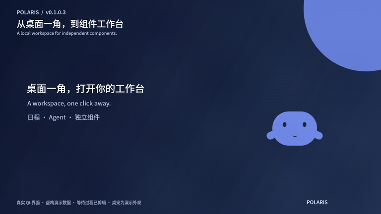

# Polaris

**A desktop pet that opens your AI workspace.**

[中文](README.md) · [Get started](#get-started) · [Preview](#preview) · [Releases](https://github.com/gonerain/Polaris-desktop/releases) · [Report an issue](https://github.com/gonerain/Polaris-desktop/issues)

Keep AI chat, schedule tasks, and tool views on one canvas, ready to open from your desktop pet. Arrange cards and install applications or component instances from the canvas settings. Polaris is for Linux users who want AI and small tools close at hand and are comfortable trying an early component ecosystem.

Current source version: **v0.2.0.0**. The public package and demo below use v0.1.0.3. The Linux `.deb` has been built, installed, and checked for startup on Ubuntu 22.04 amd64. Windows and macOS still need testing on real machines.

**[Download Linux amd64 (.deb)](https://github.com/gonerain/Polaris-desktop/releases/download/v0.1.0.3/polaris_0.1.0.3_amd64.deb)** · [Installation](#linux-package) · [Run from source](#run-from-source)

## Preview

[](docs/media/polaris-v0.1.0.3-real-demo.mp4)

[Full demo (MP4, 23 seconds)](docs/media/polaris-v0.1.0.3-real-demo.mp4) · [Recording and media notes](docs/media/README.md)

Real Qt views with fictional demo data and edited timing. The companion uses the repository's vector demo appearance rather than the installed default skin. This video makes no cloud model call and does not show AI executing tasks. The schedule view comes from the separate Schedule component.

## What you can do

- **Open your workspace from a pet.** Left-click to open the canvas; right-click to open Extensions inside the canvas settings. The bundled whale-maid skin includes interaction and idle animations.
- **Chat with AI on the canvas.** Polaris Agent has a model settings panel for DeepSeek, GLM, and GLM's international service. Save your own API key, then send a message.
- **Arrange component views.** Move, resize, collapse, and remove cards. Layouts persist, and the canvas scrolls in both directions so cards remain reachable outside the window.
- **Manage applications and components.** Install, update, and remove applications in Settings → Extensions. Manage component instances there; connect instances and approve their capabilities from each application page.

## Get started

### Linux package

Download the v0.1.0.3 [Linux amd64 package](https://github.com/gonerain/Polaris-desktop/releases/download/v0.1.0.3/polaris_0.1.0.3_amd64.deb) and [SHA-256 file](https://github.com/gonerain/Polaris-desktop/releases/download/v0.1.0.3/polaris_0.1.0.3_amd64.deb.sha256). Run these commands from their directory:

```bash
sha256sum -c polaris_0.1.0.3_amd64.deb.sha256
sudo apt install ./polaris_0.1.0.3_amd64.deb
polaris
```

You can also open **Polaris** from your application menu. The validated distribution format is a Debian/Ubuntu `.deb`. Other Linux distributions can try the source version; their desktop behavior needs separate testing.

### Your first conversation

The current interface uses Chinese labels. Follow these steps:

1. Left-click the pet to open the canvas.
2. Choose **添加组件** (Add component), select **Polaris Agent**, and confirm the requested view permissions.
3. Open **模型设置** (Model settings), choose a service, and save its API key.
4. When you see **已配置，可发送** (Configured, ready to send), enter a message. Enable **授权工具** (Authorized tools) to let the model use capabilities already authorized in the current request context.

Model conversations require internet access and your own API key. Your provider may charge for usage. Saving settings checks the local format; sending a message connects to the provider, which processes the conversation and any tool results used by the model. You can correct settings and continue without restarting the component. See the [Polaris Agent configuration reference](next/components/assistant/README.md) (Chinese) for environment variables and file locations.

Right-click the pet to open **扩展管理** (Extensions) in the canvas settings. The market uses the official Git catalog and supports searching and filtering configured sources. On first launch, Polaris installs Weixin, Schedule, and Agent Bridge from the official catalog. Existing start/stop and uninstall choices persist. Running from source requires system Git; the Debian package declares Git as a dependency.

## Current limits

- **Early release.** Validation focuses on Linux amd64 installation and startup. Windows and macOS builds and desktop behavior still need real-machine testing. On Wayland, window positioning, stacking, and input regions depend on the compositor.
- **Cloud models.** Polaris Agent currently offers the three services above. You supply internet access and an API key. “Configured” describes local settings; it does not confirm connectivity, key permissions, or account balance.
- **Component views.** The canvas hosts components that implement the Polaris native view contract. Hiding or removing a card preserves its business data; stopping a component ends its running capabilities.
- **Sources and trust.** Plugin sources can be Git repositories or local directories. Plugins manage their own dependencies. The marketplace lists actual application and component catalogs from configured sources. It does not download dependencies automatically or provide signed releases; check a component's source before installing it.
- **Interface language.** The current UI and most developer documentation are in Chinese. This README provides an English starting point.

See [platform compatibility and data locations](docs/platform-compatibility.md) (Chinese) for operating-system details.

## Feedback and contributions

[Open an issue](https://github.com/gonerain/Polaris-desktop/issues/new) with your Polaris version, operating system and desktop environment, reproduction steps, expected behavior, and actual result. Remove API keys and private messages from logs and screenshots.

Contributions can include fixes, documentation, platform test results, or new components. Read the [developer guide](next/README.md), [component contract](next/CONTRACT.md), and [architecture notes](docs/component-platform-design.md) (Chinese), find a task in [Issues](https://github.com/gonerain/Polaris-desktop/issues), and submit a [pull request](https://github.com/gonerain/Polaris-desktop/pulls).

To expose running components' public capabilities to an MCP client, see the [MCP guide](next/components/mcp/README.md) (Chinese), including its default permission policy.

## Development and builds

Polaris uses Python 3.10+, PySide6, and Qt Quick. The application entry point is `main.py`; the platform implementation lives in `next/polaris_platform`.

### Run from source

```bash
git clone https://github.com/gonerain/Polaris-desktop.git
cd Polaris-desktop
python3 -m venv .venv
.venv/bin/python -m pip install -r requirements.txt
.venv/bin/python main.py
```

On Windows, use the virtual environment's `.venv\Scripts\python.exe` instead. Windows and macOS source runs still need validation in their own environments.

`python main.py --version` prints the version. `--headless` starts the selected components, prints their status, then exits. `--config PATH` selects a configuration, and `--state-dir PATH` selects the platform's persistent data directory. Developers can also run `PYTHONPATH=next python -m polaris_platform --gui`; the module entry point without `--gui` runs a startup check and exits.

Platform installations, permissions, and startup choices live in the platform data directory. Pet position and canvas layout belong to their components. See [data locations](docs/platform-compatibility.md) (Chinese).

### Build a distribution

Build in the target operating system's own virtual environment:

```bash
.venv/bin/python -m pip install pyinstaller
.venv/bin/python -m PyInstaller --noconfirm Polaris.spec
```

The output is `dist/Polaris/`. Keep the whole directory when distributing it. A Linux build does not validate Windows or macOS output.

For the Debian package, use Ubuntu 22.04 or an equivalent glibc baseline on the target architecture:

```bash
.venv/bin/python -m pip install pyinstaller==6.16.0
.venv/bin/python tools/build_deb.py
```

This produces a `.deb` and a SHA-256 file. The Linux app checks official GitHub Releases for updates. Its updater verifies the asset's SHA-256 digest and size before opening the system installer; installation requires system authorization. After upgrading, exit and restart Polaris. User data remains in `~/.local/share/polaris-platform`, or `$XDG_DATA_HOME/polaris-platform` when set.

To publish an update, increment `next/polaris_platform/metadata.py`, rebuild, and publish a matching official tag such as `v0.1.0.3`. Attach the `.deb` and `.sha256` files. Build arm64 separately on an arm64 environment. The updater requires the GitHub asset API's `digest` field and an asset for the current architecture; it ignores drafts and prereleases.

In a frozen build, component commands using `{python}` run with the bundled interpreter and its standard-library baseline, Qt, and the platform SDK. Plugins supply their own third-party dependencies and may select their own interpreter.

### Component development

Bundled components live under [next/components](next/components). External sources declare their component directories in `polaris-source.json`; each component owns a `manifest.json`. A source can provide several components. See the [source contract](next/CONTRACT.md).

[Weixin](https://github.com/gonerain/Polaris-weixin), [Schedule](https://github.com/gonerain/Polaris-schedule), and [Agent Bridge](https://github.com/gonerain/Polaris-agent) have separate repositories and releases. Agent Bridge provides Codex/Pi integration. The bundled [Polaris Agent](next/components/assistant/README.md) provides model conversations and tool calls.

Components own their capabilities and business data. The platform supplies lifecycle management, capability discovery, routing, and permissions; the canvas supplies presentation and layout. See the [architecture notes](docs/component-platform-design.md) and [developer guide](next/README.md) for the full design and test commands.

## License and credits

Polaris **v0.1.0.3** uses [MIT](LICENSE) for code. Component and protocol versions are tracked separately. See the [changelog](CHANGELOG.md) (Chinese).

The default artwork comes from [PC2005-cloud/dsh-pet](https://github.com/PC2005-cloud/dsh-pet). The original character is by 上善无形, the whale-maid design is by ZipZipPipe, and the animations are by PC2005-cloud. This is not an official DeepSeek character. The artwork uses **CC BY-NC-SA 4.0**: attribution, noncommercial use, and share alike. Code and artwork have separate licenses. Full credits and source details ship in the [skin directory](next/components/pet/skins/dshpet/ATTRIBUTION.md).
