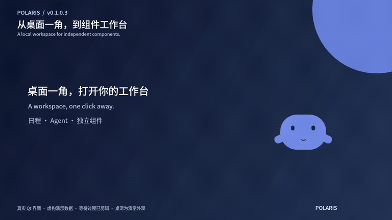

# Polaris

**让桌宠成为桌面 AI 与工具的入口。**

[English](README.en.md) · [开始使用](#开始使用) · [预览](#预览) · [版本与安装包](https://github.com/gonerain/Polaris-desktop/releases) · [反馈问题](https://github.com/gonerain/Polaris-desktop/issues)

把 AI 对话、日程待办和工具视图放在同一张画布里，从桌宠随时展开。你可以移动、折叠卡片，在画布设置的扩展管理中安装应用和组件。Polaris 适合希望随手打开 AI、整理桌面小工具，并愿意试用早期组件生态的 Linux 用户。

当前源码版本 **v0.2.0.0**；以下公开安装包与演示基于 v0.1.0.3。Linux `.deb` 已在 Ubuntu 22.04 amd64 完成构建、安装与启动验收；Windows、macOS 尚未完成实机验收。

**[下载 Linux amd64 安装包（.deb）](https://github.com/gonerain/Polaris-desktop/releases/download/v0.1.0.3/polaris_0.1.0.3_amd64.deb)** · [安装说明](#linux-安装包) · [源码运行](#从源码运行)

## 预览

[](docs/media/polaris-v0.1.0.3-real-demo.mp4)

[完整演示（MP4，23 秒）](docs/media/polaris-v0.1.0.3-real-demo.mp4) · [录制与素材说明](docs/media/README.md)

真实 Qt 界面，虚构演示数据，操作节奏经剪辑。视频使用仓库的矢量演示外观，并非安装包默认皮肤；本片未调用云模型或展示 AI 执行任务。日程视图由独立的日程组件提供。

## 可以做什么

- **从桌宠打开工作台。** 左键打开画布，右键进入画布内的扩展管理；默认鲸鱼娘皮肤带有互动和待机动画。
- **在画布中与 AI 对话。** Polaris Agent 内置模型设置，可选择 DeepSeek、GLM 或 GLM 国际站，保存自己的 API 密钥后发送消息。
- **组织组件视图。** 卡片可以移动、缩放、折叠和移除，布局会保存；画布支持横向与纵向滚动，超出窗口的卡片仍可访问。
- **管理应用与组件。** 在“设置 → 扩展管理”安装、更新和卸载应用，管理组件包及实例；在应用页连接实例并确认所需权限。

## 开始使用

### Linux 安装包

下载 v0.1.0.3 的 [Linux amd64 安装包](https://github.com/gonerain/Polaris-desktop/releases/download/v0.1.0.3/polaris_0.1.0.3_amd64.deb)和 [SHA-256 文件](https://github.com/gonerain/Polaris-desktop/releases/download/v0.1.0.3/polaris_0.1.0.3_amd64.deb.sha256)，在同一目录执行：

```bash
sha256sum -c polaris_0.1.0.3_amd64.deb.sha256
sudo apt install ./polaris_0.1.0.3_amd64.deb
polaris
```

也可从系统应用菜单打开 **Polaris**。目前验收的分发格式是 Debian/Ubuntu `.deb`；其他 Linux 发行版可尝试源码运行，具体桌面效果需要各自验证。

### 第一次打开

1. 左键点击桌宠，打开画布。
2. 点击“添加组件”，选择 **Polaris Agent**，按提示确认所需展示权限。
3. 在聊天卡片点击“模型设置”，选择服务并保存对应的 API 密钥。
4. 看到“已配置，可发送”后输入消息。需要工具时勾选“授权工具”，模型只使用本次上下文中已有授权的能力。

模型对话需要网络和所选服务的 API 密钥，服务商可能收取费用。保存设置只检查本地格式；真正发送时才连接模型服务，对话及模型使用的工具结果由所选服务处理。配置失败可在设置中修正后继续，无需重启组件。详见 [Polaris Agent 配置说明](next/components/assistant/README.md)。

右键桌宠可打开“画布设置 → 扩展管理”。设置分为外观、扩展管理和关于；扩展管理包含市场、应用、组件三页；市场读取官方 Git 目录及已配置的扩展源，可搜索、筛选和安装应用、组件。组件实例由平台保存，可被多个应用连接，各应用分别授权。停用或卸载应用会保留组件实例；显式删除实例仍需先解除引用并停止。首次启动会从官方 Git 目录安装并启动微信、日程和 Agent Bridge；已有启停和卸载选择会保留。源码运行需要系统 Git；Debian 安装包会声明 Git 依赖。

## 当前边界

- **早期版本。** 当前重点验收 Linux amd64 安装和启动。Windows、macOS 的构建与桌面效果尚待实机验证；Wayland 的窗口位置、置顶及输入区域受合成器控制。
- **云端模型。** Polaris Agent 当前提供上述三种服务，需要用户自己的 API 密钥与网络；“已配置”表示本地配置可用于发送，不代表服务连接、密钥权限或余额已验证。
- **组件视图。** 画布承载支持 Polaris 原生视图契约的组件。隐藏或移除卡片会保留业务数据；停止组件才结束其运行能力。
- **安装与信任。** 插件源支持 Git 或本地仓库。插件依赖由各插件维护，当前没有自动依赖下载或签名发布；安装组件前应确认其来源。

更详细的系统差异、运行依赖与数据位置见[平台兼容说明](docs/platform-compatibility.md)。

## 反馈与贡献

遇到问题可[提交 Issue](https://github.com/gonerain/Polaris-desktop/issues/new)。请附上 Polaris 版本、系统和桌面环境、复现步骤、预期与实际结果；日志或截图请先移除密钥和私人消息。

欢迎提交修复、文档改进、系统验收结果或新组件。开始前可查看[开发说明](next/README.md)、[组件契约](next/CONTRACT.md)和[架构说明](docs/component-platform-design.md)，阅读[扩展市场投稿说明](marketplace/README.md)，或从[现有 Issues](https://github.com/gonerain/Polaris-desktop/issues)选择问题，再通过 [Pull Request](https://github.com/gonerain/Polaris-desktop/pulls)贡献改动。

需要把已运行组件的公开能力接入支持 MCP 的 AI 客户端，可阅读 [MCP 接入说明](next/components/mcp/README.md)，其中包含连接方法和默认授权范围。

## 开发与构建

### 从源码运行

Python 3.10+；在仓库根目录建立独立环境：

```bash
git clone https://github.com/gonerain/Polaris-desktop.git
cd Polaris-desktop
python -m venv .venv
# Linux / macOS
.venv/bin/python -m pip install -r requirements.txt
.venv/bin/python main.py
# Windows
.venv\Scripts\python.exe -m pip install -r requirements.txt
.venv\Scripts\python.exe main.py
```

`python main.py --version` 显示软件版本。`--headless` 打印所选组件状态后退出。`--config PATH` 选择装配，`--state-dir PATH` 指定平台安装与授权数据目录。开发者也可运行 `PYTHONPATH=next python -m polaris_platform --gui`；模块入口不加 `--gui` 时只启动、检查并停止所选组件。

平台安装、授权与自启动设置保存在平台数据目录；桌宠位置和画布布局保存在各自组件目录。[平台运行与数据目录](docs/platform-compatibility.md)。

### 打包

在目标操作系统自己的虚拟环境中执行。Linux 需先编译 Fcitx5 的 Qt 输入插件，否则 Fcitx 环境中只能输入英文。准备与 PySide6 的 `qVersion()` 相同版本的 Qt SDK（包含私有头文件），以及 CMake、Ninja、extra-cmake-modules、libx11-dev、libxcb1-dev 和 libxkbcommon-dev：

```bash
git clone --depth 1 --branch 5.1.9 https://github.com/fcitx/fcitx5-qt.git /tmp/fcitx5-qt
python tools/build_fcitx_plugin.py --qt-prefix /path/to/Qt/6.8.3/gcc_64 --source /tmp/fcitx5-qt
```

该工具将插件安装到当前虚拟环境的 Qt 插件目录，打包时一并携带对应源码和许可。

```bash
python -m pip install pyinstaller
python -m PyInstaller --noconfirm Polaris.spec
```

输出为 `dist/Polaris/`；Windows 运行 `Polaris.exe`，Linux 运行 `Polaris`。分发时保留整个目录，不能只复制可执行文件。源码和包内默认皮肤均自带动画及许可，不依赖外部素材下载。Windows、macOS 的构建与真实桌面效果仍需分别验收，Linux 构建也不能代替其他系统构建。

#### Debian / Ubuntu 安装包与更新

在 Ubuntu 22.04 或相同 glibc 基线的 Linux 环境中构建（架构与构建机一致）：

```bash
.venv/bin/python -m pip install pyinstaller==6.16.0
.venv/bin/python tools/build_deb.py
sudo apt install ./dist/polaris_0.1.0.3_amd64.deb
```

输出包含 deb 和 SHA-256 文件；系统菜单只显示 Polaris 图标。可在 Polaris 启动图标的右键操作中选择“检查更新”，也可运行 `polaris --updates`。Linux 分发包启动后会在后台检查正式 GitHub Release，发现新版本时显示更新窗口；失败时可手动重试。

更新窗口下载当前架构的 deb，校验 GitHub 提供的 SHA-256 与文件大小后才允许打开系统安装器。安装需要系统授权；完成后退出并重新启动 Polaris。没有关联 deb 安装器时，窗口提供 `sudo apt install` 命令。用户数据仍保存在 `~/.local/share/polaris-platform`（或 `$XDG_DATA_HOME/polaris-platform`），覆盖安装保留这些数据。

发布更新时，提升 `next/polaris_platform/metadata.py` 的版本，重新构建，并在本项目 GitHub 中发布同名正式标签（如 `v0.1.0.3`）。将 `polaris_0.1.0.3_amd64.deb` 和对应 `.sha256` 上传为 Release 资源；arm64 需在 arm64 环境单独构建。更新器读取 GitHub Release API 的资源 `digest`，缺少校验值或匹配架构资源时会明确报错。预发布和草稿不会作为更新。

冻结包中组件命令的 `{python}` 使用随包解释器，提供 Python 标准库基线（不含 Tk/IDLE 和标准库测试资源）及平台 Qt/SDK；第三方依赖须由插件自行提供。需要额外依赖的插件应在自己的环境安装依赖，并在组件命令中指定该环境的解释器。

### 插件源契约

主仓库的 [next/components](next/components) 按组件分别维护运行管理、协作、授权、窗口承载、画布、桌宠、插件源、扩展管理和 Polaris Agent 的清单、实现与资源，随应用分发。其它 Git 或本地源可在扩展管理的市场页添加，再选择应用或组件安装。仓库根目录使用 `polaris-source.json` 列出组件与应用目录，分别维护 `manifest.json` 和 `polaris-application.json`。标准见 [插件源契约](next/CONTRACT.md)。

[微信](https://github.com/gonerain/Polaris-weixin)、[日程](https://github.com/gonerain/Polaris-schedule)、[Agent Bridge](https://github.com/gonerain/Polaris-agent) 独立维护和发布。Codex/Pi 接入由 Agent Bridge 提供。随包的 [Polaris Agent](next/components/assistant/README.md) 提供模型对话与工具调用，可在画布独立使用，也可为微信自动回复。插件依赖由各插件维护。

### 组件设计原则

组件分工、能力调用和故障恢复见[架构说明](docs/component-platform-design.md)。以下是 Polaris 的组件设计约束与演进方向。

- **能力归组件所有。** 每个组件负责自身功能、数据、规则和状态，通过公开能力接口协作。使用接口承诺的返回字段属于正常依赖；组件不依赖对方内部实现。
- **能力与展示分开。** 画布本身也是组件，负责呈现与组织。组件可以没有视图，隐藏视图与停止能力是不同操作。
- **协作有明确负责人。** 发起协作的一方负责本次过程的组织、失败处理和结果汇报；各参与组件负责履行自身接口承诺、反馈结果与错误。共同底座提供共同机制，具体业务规则归所属组件维护。
- **依赖与退出行为明确。** 区分可选与必需依赖：可选依赖缺失时只减少相关功能，必需依赖缺失时明确报告相关能力不可用。允许组件动态加入和退出，并明确依赖变化后的行为。
- **能力自动发现，使用范围明确授权。** 能力及权限选项随组件加入、退出而更新，新增能力不自动获得授权。授权来源与范围在调用链中保持明确，不因调用另一个组件而获得它的全部权限。

判断边界是否合理，可以问：

- 对方保持接口契约、更换内部实现时，本组件是否仍需修改？
- 对方退出后，本组件还能做什么？
- 新增组件是否迫使许多旧组件修改？
- 同一业务规则是否由所属组件统一解释和维护？

必要的跨边界输入校验仍可保留，业务含义以所属组件为准。
这些原则借鉴 [KDE Plasma](https://api.kde.org/plasma-containment.html)、[OSGi](https://www.osgi.org/resources/architecture/)
和 [Home Assistant](https://contributors.home-assistant.io/architecture/core/) 的组件与协作思想。

## 版本与许可

软件版本为 **v0.1.0.3**；组件清单版本和协议版本独立维护。[更新记录](CHANGELOG.md)。

代码采用 [MIT](LICENSE)。默认美术素材来自 [PC2005-cloud/dsh-pet](https://github.com/PC2005-cloud/dsh-pet)，角色原型作者为上善无形，女仆鲸鱼娘设计为 ZipZipPipe，并非 DeepSeek 官方形象。素材遵守 **CC BY-NC-SA 4.0：署名、非商业、相同方式共享**；代码与美术素材分别适用各自许可。完整署名、来源和许可随包保留于 [默认皮肤目录](next/components/pet/skins/dshpet/ATTRIBUTION.md)。
